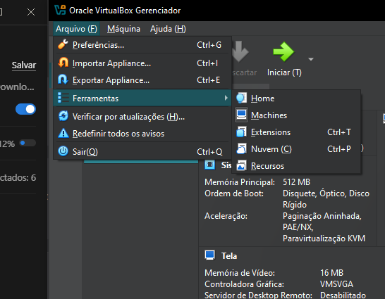
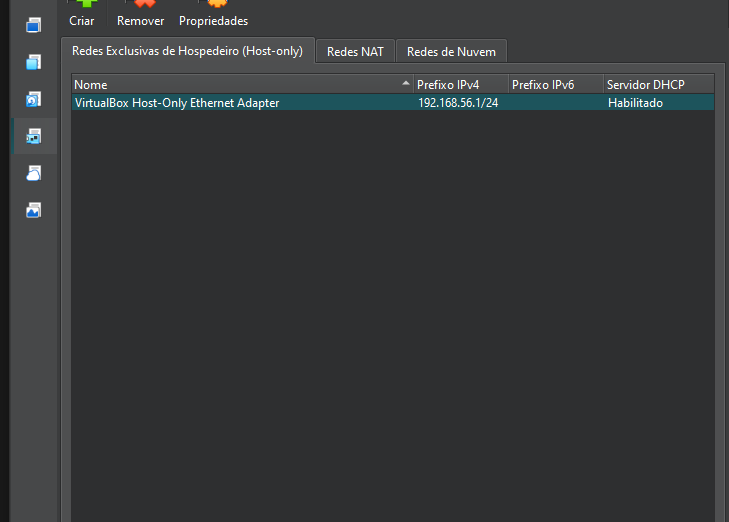
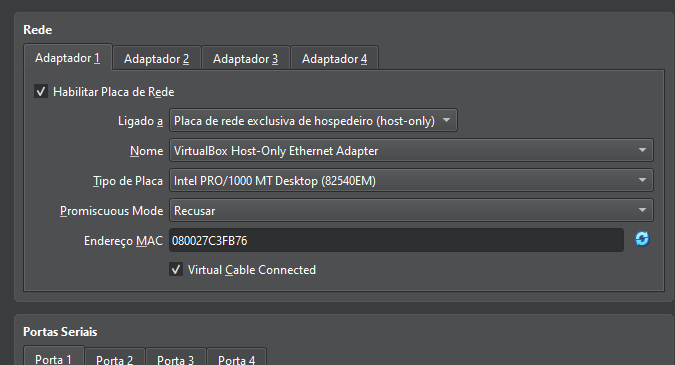
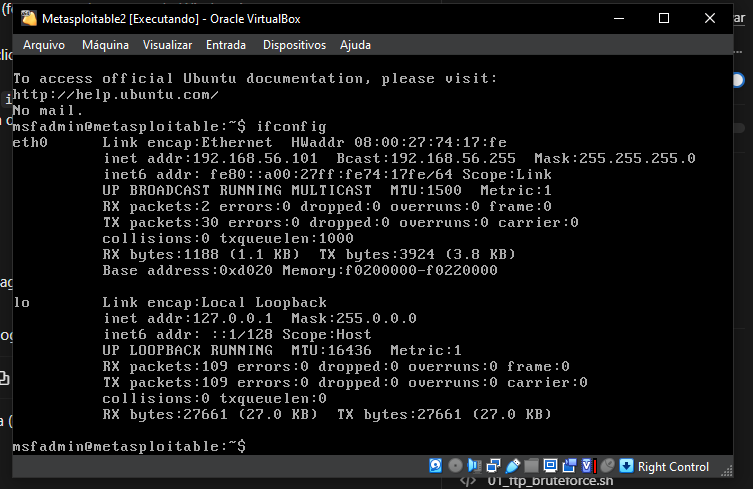
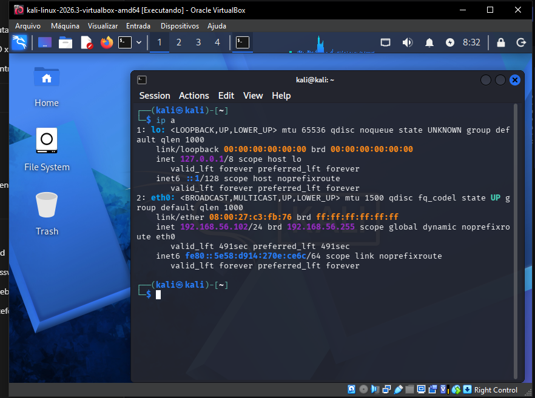
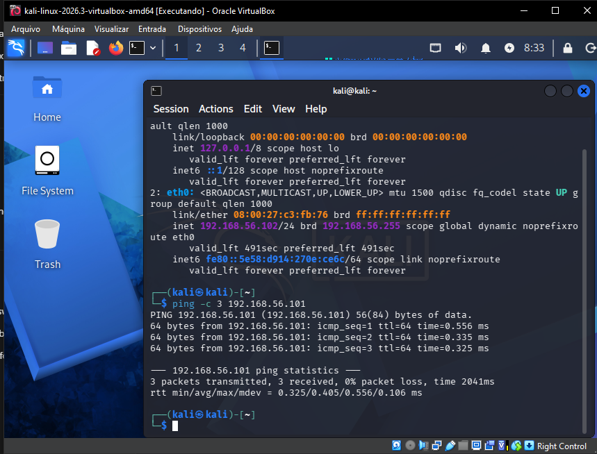

# Configuração do Ambiente

Documentação da montagem do laboratório: duas VMs no VirtualBox (Kali Linux
e Metasploitable2), conectadas por uma rede **host-only** isolada.

## 1. VMs importadas e disco do Metasploitable2 anexado

O Metasploitable2 foi baixado em formato VMware (`.vmx`/`.vmdk`). Como o
VirtualBox não importa esse formato diretamente pelo assistente padrão, a VM
foi criada manualmente e o disco `.vmdk` original foi anexado na controladora
SATA.



## 2. Rede Host-Only

Utilizada a rede host-only padrão do VirtualBox (`VirtualBox Host-Only
Ethernet Adapter`, faixa `192.168.56.0/24`), que isola completamente o
tráfego entre as VMs e o host, sem qualquer saída para a internet.



## 3. Placa de rede configurada em cada VM

Tanto o Kali quanto o Metasploitable2 tiveram o Adaptador 1 configurado como
**"Placa de rede exclusiva de hospedeiro (host-only)"**, usando a rede acima.



## 4. Confirmação dos IPs atribuídos

**Metasploitable2** — IP `192.168.56.101`:



**Kali Linux** — IP `192.168.56.102`:



## 5. Teste de conectividade

```bash
ping -c 3 192.168.56.101
```

Resultado: `3 packets transmitted, 3 received, 0% packet loss` — as duas VMs
se enxergam corretamente na rede isolada.



---

Ambiente pronto para os testes de força bruta. Próximo: [Cenário 1 — FTP](cenario-1-ftp.md).
